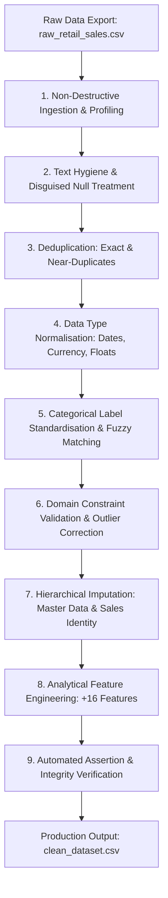

# Retail Sales: Data Ingestion, Cleaning & Preprocessing with Pandas

[](https://www.python.org/)
[](https://pandas.pydata.org/)
[](https://numpy.org/)
[](https://jupyter.org/)
[](#data-quality-scorecard)

> **Internship Programme:** Data Analytics & Business Intelligence  
> **Specialisation Task:** Production-Grade Data Ingestion, Cleaning & Preprocessing  
> **Prepared by:** Gurusaiprasadreddy  

---

## Executive Summary

Real-world enterprise transaction exports are rarely analysis-ready: they arrive laden with disguised missing values (`?`, `-`, `unknown`), mixed date conventions (`DD/MM/YYYY` vs `YYYY-MM-DD`), currency strings formatted with symbols and commas (`$1,234.50`), accounting-style negatives `($12.00)`, subtle typos in critical dimensions (`Eest`, `Technolgy`), exact duplicates, and violation of domain invariants.

This repository provides an automated, audit-logged, and deterministic end-to-end data processing pipeline implemented in Python and Pandas. The pipeline ingests **10,820 raw retail sales records** across 20 attributes, cleanses all data quality defects, recovers missing values using domain business logic, engineers 16 analytical features, and exports a clean dataset of **10,396 records across 36 columns**.

---

## Recommended Repository Structure

```text
Data-Ingestion-Cleaning-Preprocessing-Pandas/
├── data/
│   ├── raw_retail_sales.csv            # Uncleaned raw transaction export (10,820 rows x 20 cols)
│   └── clean_dataset.csv               # Curated, analysis-ready dataset (10,396 rows x 36 cols)
├── notebooks/
│   └── Data_Cleaning_Preprocessing.ipynb  # End-to-end Jupyter Notebook cleaning & audit pipeline
├── generate_raw_data.py                # Reproducible synthetic raw data generator script
├── README.md                           # Comprehensive project documentation & quality scorecard
└── .gitignore                          # Git ignore rules for environments, caches & checkpoints
```

---

## Data Pipeline Architecture



---

## Detailed Processing Stages

| Stage | Focus Area | Actions Performed & Business Rules |
| :--- | :--- | :--- |
| **1. Ingest** | Lossless Ingestion | Loads `raw_retail_sales.csv` preserving a pristine snapshot (`df_raw`) for full auditability and baseline comparison. |
| **2. Profile** | Baseline Quality Audit | Systematic profiling across missingness patterns, uniqueness ratios, data types, and statistical anomalies prior to cleaning. |
| **3. Text Hygiene** | Disguised Null Normalisation | Strips leading/trailing whitespaces; maps disguised tokens (`?`, `-`, `unknown`, `null`, `none`, `N/A`) to true `pd.NA`. |
| **4. De-duplicate** | Integrity of Business Keys | Removes 300 identical row clones and resolves 124 near-duplicates matching on composite order keys with inconsistent casing. |
| **5. Data Types** | Standardized Representation | Parses mixed date formats (`DD/MM/YYYY`, `YYYY-MM-DD`, `MM-DD-YYYY`); strips `$`, `,`, `%`; parses accounting negatives `($X.XX)` into numeric values. |
| **6. Label Standardisation** | Dimension Consistency | Collapses casing variations and typos (e.g. `Eest` &rarr; `East`, `Technolgy` &rarr; `Technology`) into canonical categories using mapping dictionaries and fuzzy matching. |
| **7. Outliers & Constraints** | Domain Invariants | Inverts sign-entry errors (e.g., negative quantities converted to positive); enforces chronological invariant (`ship_date >= order_date`); validates shipping lead-times. |
| **8. Imputation** | Deterministic & Contextual Recovery | Hierarchical recovery strategy: <br>1. Master data lookup (`customer_id`, `product_id`)<br>2. Accounting identity recovery: $\text{Sales} = \text{Quantity} \times \text{Unit Price} \times (1 - \text{Discount})$<br>3. Product-specific median fallback for residual items. |
| **9. Feature Engineering** | Business Intelligence Ready | Generates 16 derived attributes including calendar breakdowns, shipping lead-time (`shipping_days`), profit margin %, loss-making indicator, and data repair audit flags. |
| **10. Validation & Export** | Automated Assertion Gate | Comprehensive assertion suite validating data types, zero-null tolerances on primary columns, and mathematical consistency before serializing to `data/clean_dataset.csv`. |

---

## Data Quality Scorecard

| Metric | Before (Raw) | After (Clean) | Net Impact & Resolution |
| :--- | :---: | :---: | :--- |
| **Total Rows** | 10,820 | 10,396 | 424 duplicate / unusable records eliminated |
| **Total Columns** | 20 | 36 | +16 engineered analytical features |
| **Exact Duplicate Rows** | 300 | 0 | 100% resolved |
| **Repeated Order IDs** | 420 | 0 | 100% resolved on composite business keys |
| **Missing Cells (incl. Disguised)** | 4,956 (2.29%) | 0 (0.00%) | 100% resolved via identity recovery & master tables |
| **Explicit 'Unknown' Fallbacks** | 0 | 504 | Transparently marked unrecoverable attributes |
| **Columns with Type Mismatches** | 8 | 0 | Full type-safety restored (Dates, Floats, Ints) |
| **Categorical Label Variants** | 124 | 22 | Standardized into 19 canonical labels + 3 explicit 'Unknown' |

---

## Clean Dataset Schema (`data/clean_dataset.csv`)

The finalized dataset contains **10,396 records** and **36 columns** structured into logical functional blocks:

### 1. Order & Shipping Identification
- `order_id` *(string)*: Unique business order identifier (`ORD-XXXXXX`).
- `order_date` *(datetime64)*: Canonical order placement date (`YYYY-MM-DD`).
- `ship_date` *(datetime64)*: Canonical delivery / shipping date (`YYYY-MM-DD`).
- `shipping_days` *(int64)*: Calculated fulfillment latency: `ship_date - order_date`.
- `ship_mode` *(string)*: Fulfillment tier (`Standard Class`, `Second Class`, `First Class`, `Same Day`, `Unknown`).

### 2. Customer Dimension
- `customer_id` *(string)*: Master customer identifier (`CUST-XXXX`).
- `customer_name` *(string)*: Customer legal name in proper title case.
- `segment` *(string)*: Market segment (`Consumer`, `Corporate`, `Home Office`, `Unknown`).
- `region` *(string)*: Geographic territory (`East`, `West`, `South`, `Central`, `Unknown`).
- `city` *(string)*: Shipping destination city.

### 3. Product & Merchandising Dimension
- `product_id` *(string)*: Master catalog stock item (`PRD-XXX`).
- `product_name` *(string)*: Formal product title.
- `category` *(string)*: Primary departmental classification (`Furniture`, `Office Supplies`, `Technology`).
- `sub_category` *(string)*: Granular product class (e.g., `Chairs`, `Binders`, `Phones`).

### 4. Financial & Transactional Metrics
- `quantity` *(int64)*: Units purchased ($\ge 1$).
- `unit_price` *(float64)*: Item price in USD before discounts.
- `discount` *(float64)*: Decimal discount rate (e.g., `0.20` for 20%).
- `discount_pct` *(float64)*: Percentage discount (e.g., `20.00%`).
- `gross_sales` *(float64)*: Pre-discount total: $\text{quantity} \times \text{unit\_price}$.
- `discount_amount` *(float64)*: Dollar reduction: $\text{gross\_sales} \times \text{discount}$.
- `sales` *(float64)*: Net recognized revenue: $\text{gross\_sales} - \text{discount\_amount}$.
- `cost` *(float64)*: Cost of Goods Sold (COGS).
- `profit` *(float64)*: Net margin: $\text{sales} - \text{cost}$.
- `profit_margin_pct` *(float64)*: Profit margin: $(\text{profit} / \text{sales}) \times 100$.
- `is_loss_making` *(bool)*: Boolean flag indicating if transaction was unprofitable ($\text{profit} < 0$).
- `order_size` *(string)*: Transaction size tier (`Small (1-2)`, `Medium (3-5)`, `Large (6+)`).
- `payment_method` *(string)*: Settlement channel (`Credit Card`, `Debit Card`, `Cash`, `UPI`, `PayPal`).

### 5. Temporal Engineering & Auditability
- `order_year`, `order_month`, `order_month_name`, `order_quarter`, `order_year_month`, `order_weekday`, `is_weekend`: Calendar decomposition features for time-series analysis and cohort tracking.
- `fields_repaired` *(int64)*: Total number of attributes imputed or transformed for this order.
- `was_repaired` *(bool)*: Audit indicator indicating if row underwent any repair during the ingestion pipeline.

---

## Getting Started & Execution

### Prerequisites
Ensure Python 3.9+ is installed along with the required libraries:
```bash
pip install pandas numpy matplotlib jupyter
```

### 1. Generating Raw Messy Data (Optional)
To regenerate or inspect how the realistic messy dataset is generated:
```bash
python generate_raw_data.py
```
*Output: Generates `data/raw_retail_sales.csv` (10,820 rows).*

### 2. Running the Cleaning & Preprocessing Pipeline
Launch Jupyter Notebook or execute the notebook directly:
```bash
jupyter notebook notebooks/Data_Cleaning_Preprocessing.ipynb
```
*The notebook automatically resolves relative paths regardless of whether it is launched from the project root or from inside `notebooks/`.*

---

## Key Engineering Highlights

- **Lossless & Traceable:** Raw data is never modified in-place; all changes are logged to an in-memory audit dataframe.
- **Identity-First Imputation:** Instead of arbitrary mean or median fills, financial metrics are reconstructed algebraically using $\text{sales} = \text{qty} \times \text{price} \times (1 - \text{discount})$.
- **Master Data Consistency:** Entity relationships between customer ID & customer attributes, and product ID & product hierarchy are strictly enforced.
- **Fail-Safe Portability:** The notebook and generator automatically locate the data directories whether run from root or subdirectory.

---

## License & Attribution

Developed as part of the **Data Analytics & Business Intelligence Internship** by **Gurusaiprasadreddy**. Distributed under the [MIT License](https://opensource.org/licenses/MIT).
